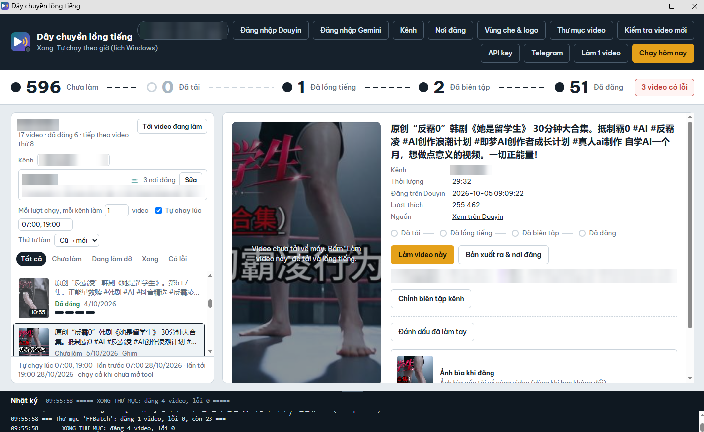
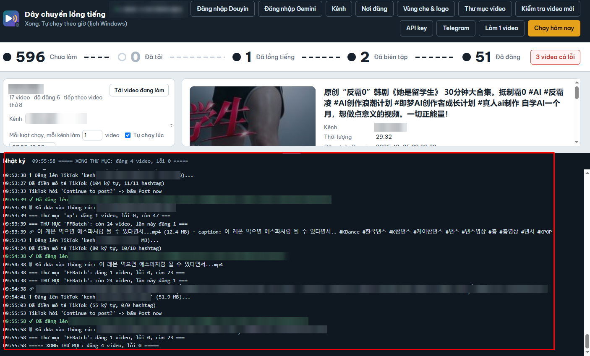
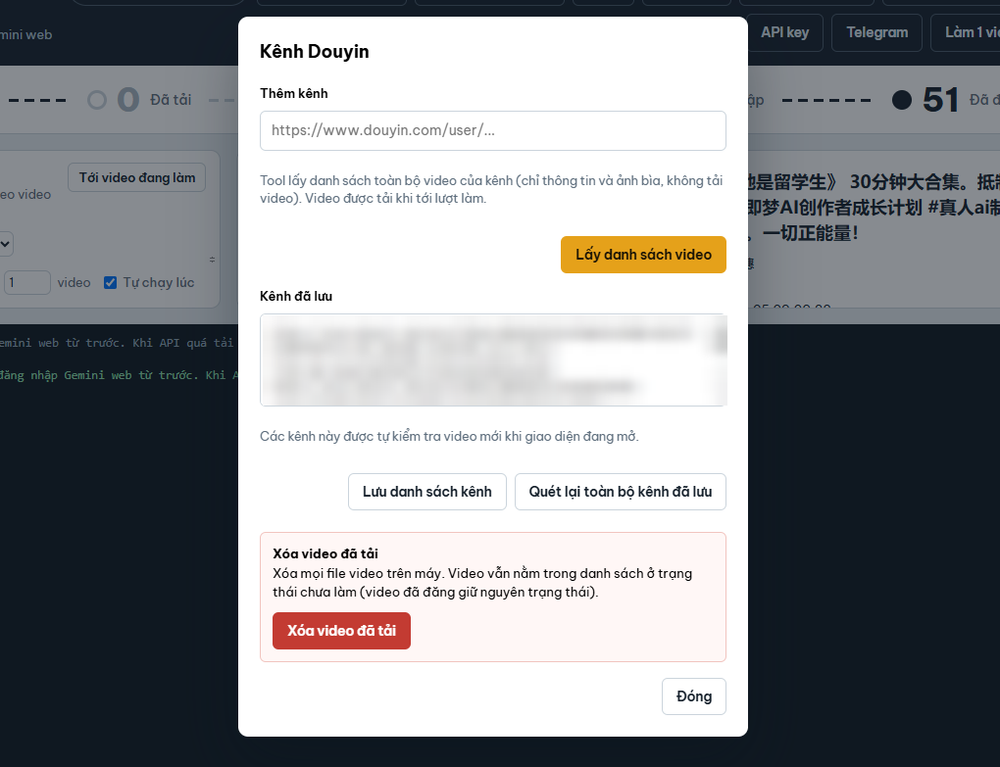
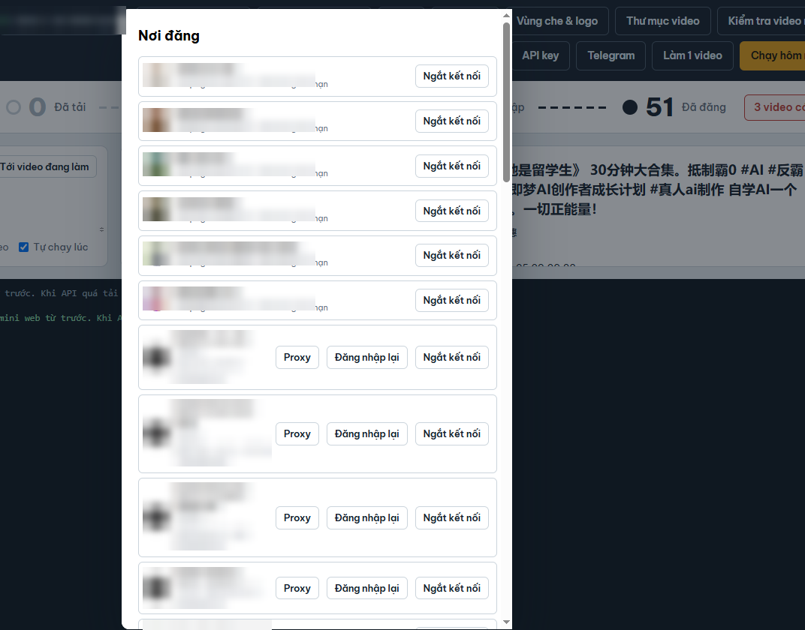

# ToolDouyin-ban-cai

Bộ cài **Tool Douyin** (tool tự tải bản mới từ đây). Mã nguồn không ở đây.

## Tải về
Vào mục **[Releases](https://github.com/Sa-luy/ToolDouyin-ban-cai/releases/latest)** → tải file `ToolDouyin_Setup_<phiên bản>.exe` → bấm đúp để cài.

## Tool làm gì
Tự động lấy video từ các kênh **Douyin** → **lồng tiếng AI** sang ngôn ngữ khác → biên tập → **đăng lên Fanpage Facebook / TikTok**.

### Quy trình cho mỗi video
1. **Theo dõi kênh**: dán link các kênh Douyin, mỗi ngày tool tự kiểm tra video mới và làm lần lượt từ cũ đến mới.
2. **Tải video** bản sạch + ảnh bìa.
3. **Nhận lời thoại** tiếng Trung bằng AI (Whisper).
4. **Dịch cả kịch bản** bằng Gemini (giữ đủ câu, phân vai người nói) sang các ngôn ngữ bạn chọn (Việt, Hàn, ...).
5. **Lồng tiếng AI** nhiều giọng theo từng vai (chỉ lồng tiếng, không chèn phụ đề).
6. **Biên tập**: che phụ đề / logo gốc, chèn logo của bạn, hạ nhạc nền khi có giọng đọc, làm nét nhẹ, chỉnh màu,
   xóa thông tin gốc của file.
7. **Đăng bài**: mỗi ngôn ngữ gắn với Fanpage / tài khoản TikTok riêng (TikTok hỗ trợ proxy riêng từng tài khoản).
   Đã đăng thì không bao giờ đăng lại; đăng xong tự xóa file video để đỡ tốn ổ cứng.

### Nguồn thứ 2: thư mục video trên máy
Mỗi kênh TikTok gắn 1 thư mục; bỏ video vào (kèm file `.txt` cùng tên làm mô tả) là tool tự đăng.

### Chạy tự động
- Tự chạy theo giờ mỗi ngày (mặc định **07:00** và **19:00**), kể cả khi chưa mở giao diện.
- Điều khiển và nhận báo cáo từng bước qua **Telegram bot** trên điện thoại.
- **Tự cập nhật**: có bản mới, tool tự tải và cài khi rảnh, rồi báo qua Telegram.

## Hình ảnh giao diện

**Màn hình chính**: tiến độ từng bước (chưa làm → đã tải → đã lồng tiếng → đã biên tập → đã đăng), danh sách video
của từng kênh, xem trước video và nơi đăng theo ngôn ngữ.

**Nhật ký**: báo từng bước đang làm (tải lên, điền mô tả, đăng xong, dọn file...).

**Kênh Douyin**: dán link kênh để tool lấy danh sách video và tự theo dõi video mới.

**Nơi đăng**: kết nối nhiều Fanpage Facebook và tài khoản TikTok (mỗi tài khoản TikTok có thể dùng proxy riêng).

## Yêu cầu
- Windows 10 / 11 (64-bit), có Microsoft Edge (Windows có sẵn), kết nối mạng.
- Ổ cứng trống vài chục GB (video tạm + model AI ~1.6 GB tải tự động ở lần lồng tiếng đầu tiên).
- **Tài khoản dùng tool** (liên hệ bên dưới để được cấp).

## Bắt đầu sử dụng
1. Cài xong, mở **Tool Douyin** ở Desktop → đăng nhập tài khoản dùng tool.
2. Bấm **Đăng nhập Douyin**, **Đăng nhập Gemini** (hoặc nhập Gemini API key ở nút **API key**).
3. **Nơi đăng**: kết nối Fanpage / tài khoản TikTok, chọn ngôn ngữ cho từng nơi.
4. **Kênh**: dán link kênh Douyin, chọn ngôn ngữ cần lồng tiếng.
5. Bấm **Chạy hôm nay** để chạy thử, hoặc để tool tự chạy theo giờ.

## Liên hệ
- Telegram: **[@jockersaluy](https://t.me/jockersaluy)** (mua / gia hạn tài khoản, hỗ trợ cài đặt)
